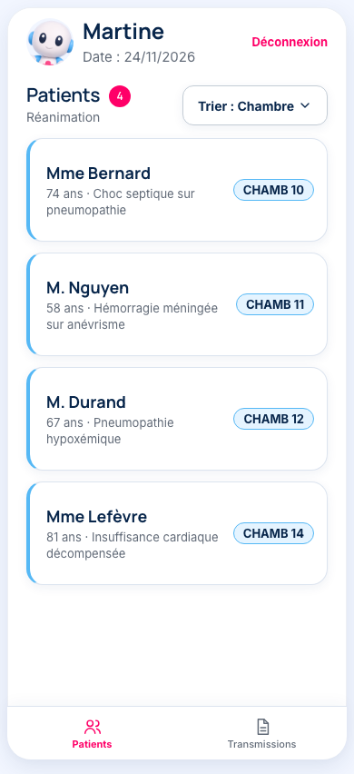
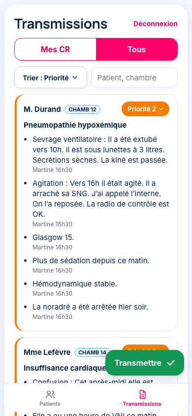

>🏅 **Lauréat du prix "Organisation des Soins" au [Hackaton Adopt AI For Health](https://hackathons-artefactadoptai.agorize.com/en/challenges/hackathon-adopt-ai-for-health?lang=en), Novembre 2026. Défi porté par l'[Hôpital Foch](https://www.hopital-foch.com/), Paris.**

<h1 align="center">Bino</h1>

<p align="center">
  <em>Le binôme des infirmiers.</em>
</p>

<p align="center">
  
</p>

<p align="center">Rendre à Martine, infirmière, le temps que l'administratif lui prend pour le rendre au patient.</p>

<p align="left">
  <a href="https://bino.noiseless-sunflower.workers.dev"><b>Essayer →</b></a>
</p>

Matricule `10482`, mot de passe `bino`. Patients fictifs.

Captures réelles de l’application sur mobile :

<table>
  <tr>
    <td align="center" width="25%"><br><sub>Connexion</sub></td>
    <td align="center" width="25%"><br><sub>Patients</sub></td>
    <td align="center" width="25%"><br><sub>Compte rendu</sub></td>
    <td align="center" width="25%"><br><sub>Transmissions</sub></td>
  </tr>
</table>

## Lancer

```bash
pnpm install
pnpm dev:api
```

L'API écoute sur le port 8787. Copie `.env.example` en `.env`. Sans clé OpenRouter, les notes passent par les règles locales.

Le site statique : `pnpm dev:web` (http://localhost:8080). Le site public relaie `/api/bino` vers le mini.

```bash
pnpm lint
pnpm test
pnpm typecheck
pnpm test:e2e
pnpm live
```

## Licence

[Apache-2.0](LICENSE). Copyright 2026 Bino.
