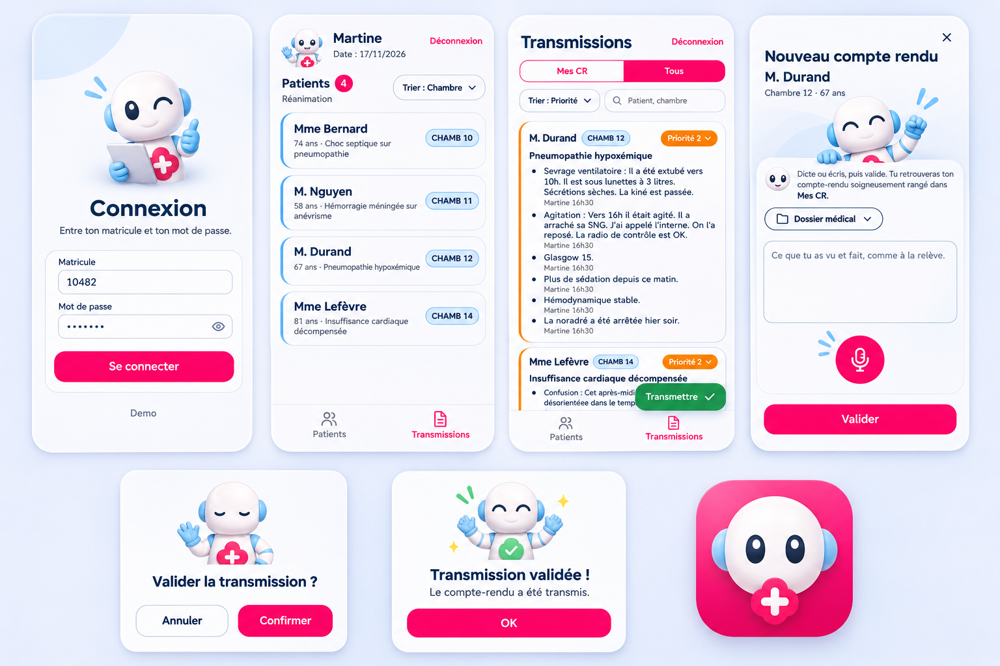

# Bino · prototype web (le binôme des infirmiers)

Démo du hackathon IA santé ARS × AdoptAI (novembre 2026), défi Hôpital Foch « infirmier augmenté ».

Bino suit les maquettes papier de l'équipe, aux couleurs du logo (rose Bino, bleu ciel). Connexion par matricule de démo. **Patients** : logo Bino, prénom du soignant, la date, 11 patients triables par **chambre** ou **nom** (pas de priorité sur le dashboard). Un patient ouvre **Nouveau compte rendu** : **Dossier médical**, grande zone de texte, **micro**, **Valider** en bas, puis « ✓ Compte rendu fait ». **Transmissions** : **Mes CR** du plus récent au plus ancien ; **Tous** : résumé en puces par patient, du plus récent au plus ancien, rangé par priorité ; la priorité 1 à 4 (proposée par l'IA) se change dans la carte via de petits cercles 1 2 3 4.

Le détail de chaque écran, des règles (priorités, NEWS2, zéro information inventée) et du stockage est dans [`FONCTIONNEMENT.md`](FONCTIONNEMENT.md).

> **Données entièrement fictives.** Ne jamais saisir de données réelles de patients : la démo n'est ni hébergée HDS ni conforme RGPD pour des données de santé.

## Aperçu du design

Direction approuvée : fond bleu pâle, surfaces blanches, titres navy, actions rose vif et mascotte Bino.
Le logo officiel remplace l’ancien dans les assets et l’application. L’extérieur bleu-violet est transparent ; le carré rose et Bino restent ceux de l’image fournie.




Captures de référence : [connexion](assets/design/screens/01-login.png) · [patients](assets/design/screens/02-patients.png) · [transmissions](assets/design/screens/03-transmissions.png) · [nouveau compte rendu](assets/design/screens/04-new-report.png) · [confirmation](assets/design/screens/05-confirm-transmission.png) · [succès](assets/design/screens/06-transmission-success.png).

---

## Tester en 30 secondes

**Sur téléphone ou ordinateur :** ouvrez le lien Cloudflare de l'équipe (`https://bino.<sous-domaine>.workers.dev`, déployé à chaque push sur `proto`). Aucun compte ni installation : tous les téléphones partagent les mêmes comptes rendus et priorités. Autre option : le lien de l'artifact Claude, ou en local (voir plus bas).

Sur iPhone : Safari › Partager › « Sur l'écran d'accueil » pour l'avoir comme une app.

**Parcours de démo conseillé (2 minutes)**

1. Connectez-vous (matricule 10401, mot de passe `bino`). **Patients** : rangés par chambre ; **Trier** : par chambre ou par nom.
2. Touchez M. Jean Dupond (12) : **Nouveau compte rendu**. Ouvrez **Dossier médical** pour voir constantes et NEWS2.
3. Dictez au **micro** (ou écrivez, ou touchez l'exemple), puis **Valider** : « Compte rendu fait ».
4. **Transmissions › Mes CR** : vos comptes rendus, le plus récent en haut. **Tous** : le résumé en puces de toute l'équipe, le plus récent en haut ; touchez « Priorité 3 » de M. Garnier : les cercles 1 2 3 4 s'ouvrent dans la carte, choisissez 1.

---

## Fonctionnalités

| Écran | Ce qu'on peut faire |
| --- | --- |
| Patients | Logo + prénom + date ; tri par **chambre** ou **nom** ; pas de priorité affichée |
| Nouveau compte rendu | **Dossier médical** (constantes, NEWS2 détaillé, infos, saisie manuelle) ; compte rendu au **micro** ou au clavier ; **Valider** puis « Compte rendu fait » |
| Transmissions | **Mes CR** du plus récent au plus ancien (pas de suppression) ; **Tous** : résumé en puces par patient, du plus récent au plus ancien, auteur et heure sous chaque puce ; rangé par priorité ; **Priorité 1 à 4** proposée par l'IA (raison factuelle, jamais sous le NEWS2, repli NEWS2), modifiable dans la carte (cercles 1 2 3 4) |

### Ce qui marche où

| | Cloudflare (lien public) | Dans Claude (lien artifact) | Local (serveur statique) |
| --- | --- | --- | --- |
| Accès | N'importe quel téléphone, sans compte | Compte Claude, partage en **Contributeur** | Cet ordinateur |
| Comptes rendus, priorités, résumés | **Partagés** entre tous les téléphones (mis à jour toutes les 5 s) | **Partagés en temps réel** | Sur cet appareil seulement |
| Résumés et priorités | IA via le Worker si la clé est configurée, sinon règles locales + NEWS2 | IA de Claude | Règles locales (ou clé API Anthropic) |
| Dictée vocale | Chrome (Android, ordinateur), Safari iOS ; sinon micro du clavier | Selon l'app Claude | Idem Cloudflare |

### Cloudflare : stockage commun et IA

Le Worker (`worker/index.js`) sert l'app et deux API :

- `/api/state`, `/api/op` : un **Durable Object** (SQLite) garde les comptes rendus, priorités, constantes et résumés du service, communs à tous les téléphones. Les comptes rendus de démo sont versés au premier lancement.
- `/api/ai` : appel à Claude **côté serveur**. La clé n'est jamais dans le code ni dans le navigateur.

Pour activer l'IA et la remise à zéro, ajoutez dans GitHub › Settings › Secrets › Actions :

| Secret GitHub | Rôle |
| --- | --- |
| `ANTHROPIC_API_KEY` | clé API (de préférence une clé de test à budget limité) ; sans elle, règles locales |
| `BINO_RESET_CODE` | code libre pour remettre la démo à zéro |

Le prochain push sur `proto` les copie dans les secrets du Worker. Garde-fous : 400 appels IA par jour (`AI_DAILY_LIMIT` dans `wrangler.jsonc`), prompts et comptes rendus de taille limitée.

Remettre la démo à zéro (avant le jury, par exemple) :

```bash
curl -X POST https://bino.<sous-domaine>.workers.dev/api/op \
  -H 'content-type: application/json' -d '{"op":"reset","code":"<BINO_RESET_CODE>"}'
```

Le prochain téléphone qui ouvre l'app reverse les comptes rendus de démo.

Tester le Worker en local : `npx wrangler@4 dev` (secrets de test dans `.dev.vars`, ignoré par git).

Dans Claude, pour que l'équipe puisse écrire, partagez le lien en **Contributeur** (les Lecteurs voient sans écrire).


---

## Lancer en local

Depuis la racine du dépôt, démarre l'API et le site dans deux terminaux. Le site sert les assets
statiques et transmet ses appels à l'API locale ; ouvrir `index.html` directement ne suffit pas.

```bash
pnpm install
pnpm dev:api                  # terminal 1 · API sur http://localhost:8787
```

Dans un second terminal, toujours depuis la racine :

```bash
pnpm dev:web                  # terminal 2 · site sur http://localhost:8080
```

Ouvre <http://localhost:8080>. Pour arrêter les serveurs, fais `Ctrl+C` dans chaque terminal.

Pour tester sur un téléphone du même Wi-Fi : `http://<IP-de-votre-ordinateur>:8080`. La dictée vocale du navigateur demande HTTPS : utilisez plutôt le lien de démo.

```bash
npm test                     # score NEWS2
```

---

## Place dans le monorepo

Ce dossier est le site déployé. Il n'est pas dans le workspace pnpm : il parle à l'API en HTTP.
Les patients et les comptes rendus viennent de cette API. Il n'y a pas de seconde liste locale, ni de seconde IA dans le navigateur.

```bash
npm test
```

## Architecture

Aucune étape de build : HTML, CSS et modules JavaScript natifs.

```
index.html               page unique, barre d'onglets
css/styles.css           identité visuelle Bino (Plus Jakarta Sans, Nunito, magenta, bleu ciel, bleu nuit)
js/app.js                état, actions, feuilles (constantes, réglages)
js/views.js              rendu : en-tête, Patients, popup patient, Transmissions
js/store.js              comptes rendus reçus de l'API
js/document.js           document de transmission (vue, texte à copier, fichier HTML)
js/triage.js             niveaux de priorité affichés
js/news2.js              calcul NEWS2 (échelle SpO2 n°1)
js/data.js               comptes de démo et exemples de dictée
js/services/voice.js     dictée : Apple sur iPhone, enregistrement vers l'API sur ordinateur
tests/                   tests Node du score NEWS2 (node --test)
```

Les fiches viennent de l'API. Le navigateur ne classe pas les phrases lui-même.

---

## Choix de conception

- **Rien n'est inventé.** Un champ non dit reste vide et devient une relance. Le R (résultat) est le plus oublié : Bino le signale au lieu de le deviner.
- **L'humain valide tout.** Les propositions se corrigent d'un appui ; rien n'est versé au dossier sans validation.
- **Aucun geste en plus.** On parle comme à la relève ; l'outil range.
- **Le DPI reste la source de vérité.** Un futur import montrera l'écart avant d'écraser.
- **Une seule vérité pour la relève.** Chacun écrit ses comptes rendus ; la transmission finale les fusionne et garde la trace de qui a dit quoi.

## Pistes suivantes

Relève orale enregistrée et retranscrite, relève « différentielle » par infirmier, trames par service, export FHIR des transmissions validées (`DocumentReference`), hébergement HDS et analyse d'impact.
